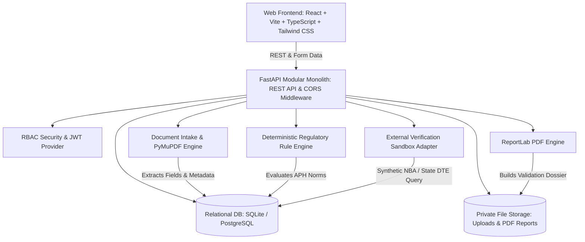

# NiyamAI — System Architecture & Design Specification
**SIH Problem Statement:** 26261 (Smart Automation, AICTE Regulation Bureau)

---

## 1. Executive Summary

NiyamAI is an end-to-end regulatory intelligence decision-support platform designed for the All India Council for Technical Education (AICTE). It automates the intake, extraction, verification, deterministic rule compliance evaluation, and audit tracking of institutional Extension of Approval (EoA) and regulatory applications while preserving full human-in-the-loop oversight and statutory authority.

---

## 2. Architecture Diagram (Mermaid)

---

## 3. Core Modules & Responsibilities

### 3.1 Backend Service Layer (`backend/app/services/`)
1. **`document_service.py`**: Validates file size (max 25MB), checks allowed extensions (`.pdf`, `.png`, `.jpg`), computes SHA-256 digests, detects exact file duplicates across applications, and manages private local storage.
2. **`extraction_service.py`**: Interacts with PyMuPDF (`pymupdf`) to extract embedded PDF text per page, document metadata (producer, creator, creation date, modification timestamp), regex-based field parsing for AICTE IDs, certificate numbers, validity dates, and sanctioned intake. Flags anomalies (e.g. image editing software stamps, pixel inconsistencies).
3. **`consistency_service.py`**: Performs cross-document consistency checks between application form fields (intake, legal name, permanent code) and submitted documents.
4. **`validation_service.py`**: Orchestrates the multi-stage validation pipeline: resolves active published handbook rules, checks document presence, evaluates deterministic rules, executes authority verifications, and creates structured evidence-linked Findings.
5. **`review_service.py`**: Implements the official review workflow, enforcing mandatory reason logging for every confirm, dismiss, rectification request, or escalation action.
6. **`report_service.py`**: Generates high-fidelity, printable, official PDF Validation Dossiers with ReportLab, complete with statutory disclaimers.

### 3.2 Regulatory Rule Engine (`backend/app/rules/`)
- Purely declarative JSON rule configurations tied to exact clauses in the AICTE Approval Process Handbook (APH).
- Evaluates:
  - Required document presence
  - Certificate validity and expiry dates
  - Institution identifier exact matches
  - Numerical thresholds (intake, built-up land area)
  - Duplicate file reuse
  - Document integrity & visual anomalies
- Produces structured results: `passed`, `failed`, `warning`, `not_checked`, `manual_review_required`. Historical findings remain permanently bound to the exact rule version active at evaluation time.

### 3.3 External Authority Verification Sandbox (`backend/app/adapters/`)
- Implements an extensible adapter interface (`verification_base.py`).
- Synthetic authority adapter (`synthetic_authority.py`) simulates live queries against:
  - National Board of Accreditation (NBA)
  - State Directorate of Technical Education (State DTE)
  - AICTE Central Regulatory Registry
- Handled outcomes: `verified`, `mismatch_detected`, `expired`, `source_unavailable`, `manual_review_required`.
